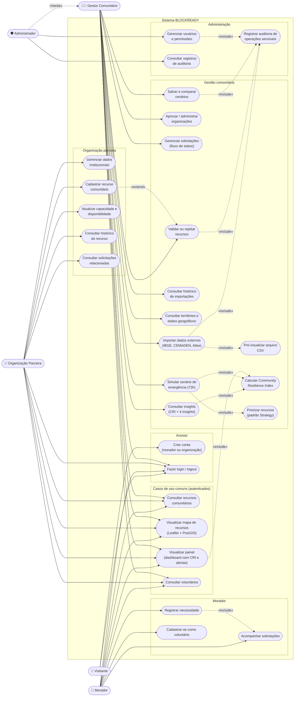

# Diagrama de Casos de Uso — BLOCKREADY

Atores e casos de uso do sistema completo (Etapas 1–5), levantados do código implementado
(controllers, regras de autorização por perfil e telas). Renderizável no GitHub/VS Code (Mermaid).

**Atores:** Visitante (não autenticado), Morador, Organização Parceira, Gestor Comunitário e
Administrador. O Administrador herda todos os casos de uso do Gestor; todos os perfis autenticados
compartilham os casos de uso comuns.

## Descrição resumida dos casos de uso

| # | Caso de uso | Atores | Resumo |
|---|---|---|---|
| UC01 | Criar conta | Visitante | Cadastro público como Morador ou Organização (organização nasce pendente de aprovação) |
| UC02 | Login/logout | Todos | Sessão autenticada (cookie HttpOnly + CSRF, senha BCrypt) |
| UC03 | Consultar recursos | Autenticados | Lista com filtros (categoria, status, nome, raio geográfico); pendentes nunca aparecem como confirmados |
| UC04 | Mapa de recursos | Autenticados | Recursos, malha dos setores IBGE e estações CEMADEN no Leaflet |
| UC05 | Painel | Autenticados | Contagens do banco, CRI por categoria e alertas informativos |
| UC06 | Consultar voluntários | Autenticados | Voluntários ativos e suas disponibilidades |
| UC07 | Registrar necessidade | Morador | Necessidade por categoria gera solicitação com prioridade |
| UC08 | Acompanhar solicitações | Morador (próprias) / Org / Gestor | Fluxo ABERTA → EM_ANALISE → EM_ATENDIMENTO → ATENDIDA, com histórico |
| UC09 | Cadastrar-se como voluntário | Morador | Habilidades e disponibilidade |
| UC10 | Gerenciar dados institucionais | Organização | Atualização dos dados da própria organização |
| UC11 | Cadastrar recurso | Organização (aprovada) / Gestor | Recurso nasce pendente de validação |
| UC12 | Atualizar disponibilidade | Organização dona / Gestor | Capacidade total/disponível com registro histórico |
| UC13 | Histórico do recurso | Organização dona / Gestor | Alterações e registros de disponibilidade |
| UC14 | Solicitações relacionadas | Organização | Solicitações das categorias que a organização atende |
| UC15 | Validar/rejeitar recursos | Gestor | Só recursos validados contam nas análises; gera auditoria |
| UC16 | Administrar organizações | Gestor | Aprovar, rejeitar, suspender |
| UC17 | Gerenciar solicitações | Gestor | Transições de status com responsável e registro de atendimento |
| UC18 | Importar dados externos | Gestor | CSV do IBGE/CEMADEN/Atlas com validação e duplicidade |
| UC19 | Pré-visualizar arquivo | Gestor | Primeiras linhas + colunas antes de importar |
| UC20 | Histórico de importações | Gestor | Fonte, arquivo, período, totais, status, erros |
| UC21 | Territórios | Gestor | Setores censitários, estações, resumo da base geográfica |
| UC22 | Insights | Gestor | CRI + 4 insights estratégicos com explicabilidade |
| UC23 | Simular cenário 72h | Gestor | Tipo de emergência, horizonte, % afetados, parâmetros de demanda |
| UC24 | Salvar/comparar cenários | Gestor | Persistência da simulação e dos indicadores de cobertura |
| UC25 | Calcular CRI | Sistema | Capacidade ÷ demanda × 100 por categoria (unidades compatíveis) |
| UC26 | Priorizar recursos | Sistema | Estratégia por tipo de emergência (padrão Strategy) |
| UC27 | Gerenciar usuários | Administrador | Criar contas, alterar perfil, ativar/desativar |
| UC28 | Consultar auditoria | Administrador | Registros de operações sensíveis |
| UC29 | Registrar auditoria | Sistema | Include das operações sensíveis (validação, importação, permissões, cenários) |
